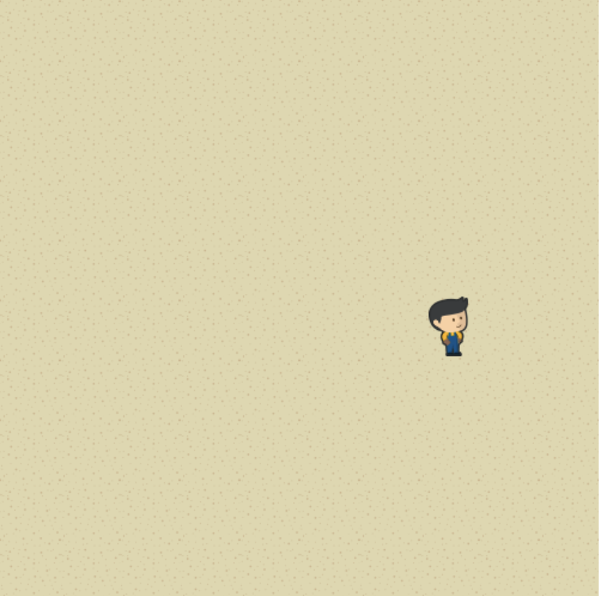

## Ejemplo de control con el celular

Este repo permite controlar el juego Wollok desde el celular con un joystick virtual o con el sensor de movimiento.
Los botones **A** y **B** conservan sus acciones, y **C** reinicia la partida.
Después de conectar, elegí **Usar joystick** para mover la palanca analógica o **Usar sensor del celular** para controlar inclinando el celular. La brújula permanece visible y los botones están disponibles en ambos modos. En el modo joystick, la aguja sigue la dirección de la palanca y podés usarla a la vez que tocás los botones. En horizontal, el joystick queda a la izquierda y los botones a la derecha; en vertical, los controles se acomodan uno debajo del otro.

### Controlá al jugador usando tu celular ➡️ 📱

⚠️ Necesitás tener la compu y el celu en la misma red wifi 🛜 preferentemente al _hotspot_.

1. Clonate este repo y desde una consola dentro de la carpeta ejecutá
  - `npm install`


2. Levantá este juego Wollok desde el VSCode (como lo harías normalmente). 
Fijate que el en la terminar te diga:
`Ya podés conectar tu celular a ws://localhost:8080`
Asegurate de que el juego se vea en la pantalla.


2. Desde otra consola, entrá a la carpeta `web` en este repo y ejecutá
  - `npm install`
  - `npm run dev`

  Eso debería servir una página web por el protocolo `https`. Por ejemplo
  ```
    VITE v8.3.1  ready in 154 ms
  ➜  Local:   https://localhost:5173/
  ➜  Network: https://192.168.43.170:5173/  en0
  ➜  press h + enter to show help
  ```

3. Desde el celu, entrá al sitio que levanteste antes (Network). 
> Siguendo este ejemplo debería ser https://192.168.43.170:5173/

Acá deberías ver el control del juego y un botón de "Conectar".


4. En **IP de la laptop**, ingresá la IP que aparece en la línea `Network` de Vite (por ejemplo, `192.168.1.25`) y apretá `Conectar`.

5. Cuando aparezcan las opciones, elegí el joystick o el sensor. Ya podés controlar al personaje con tu celu 🫨

Si cambiás de red, conectá la computadora y el celular a la misma Wi-Fi y usá la IP `Network` actual de Vite. La IP puede cambiar entre redes; no hace falta fijarla en el código.
> Fijate que al conectarse la terminal del juego diga `✓ Celular conectado`